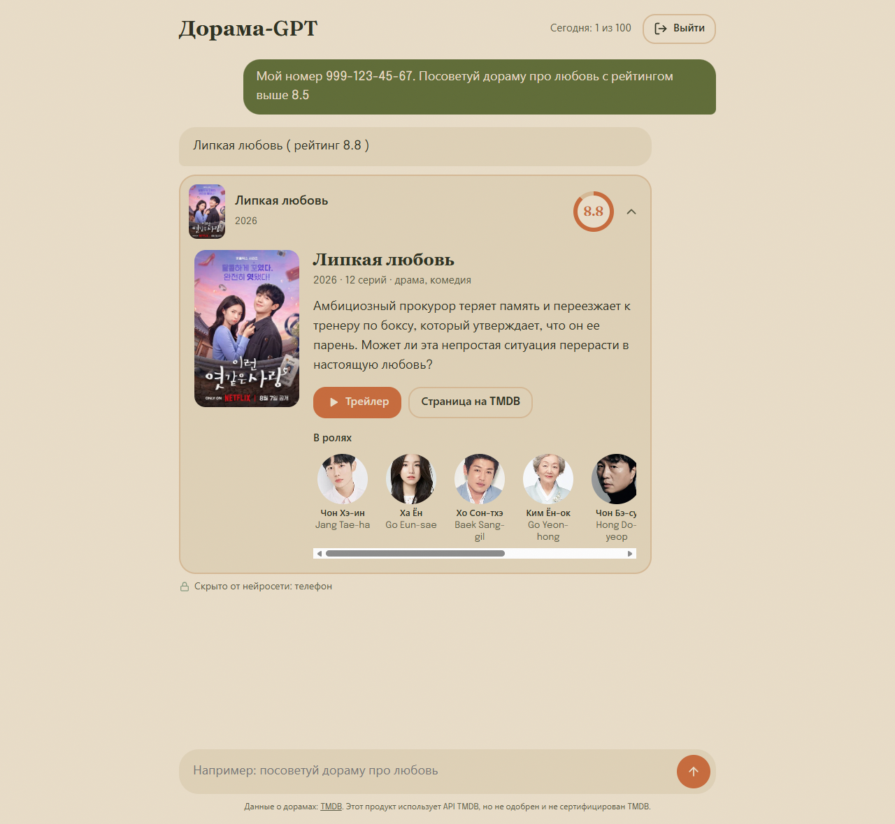
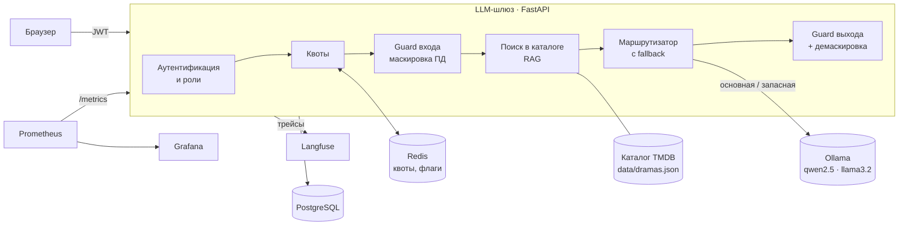
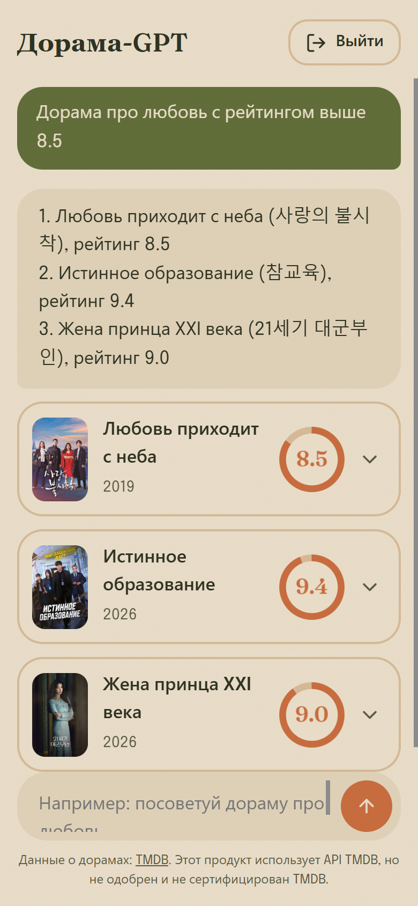
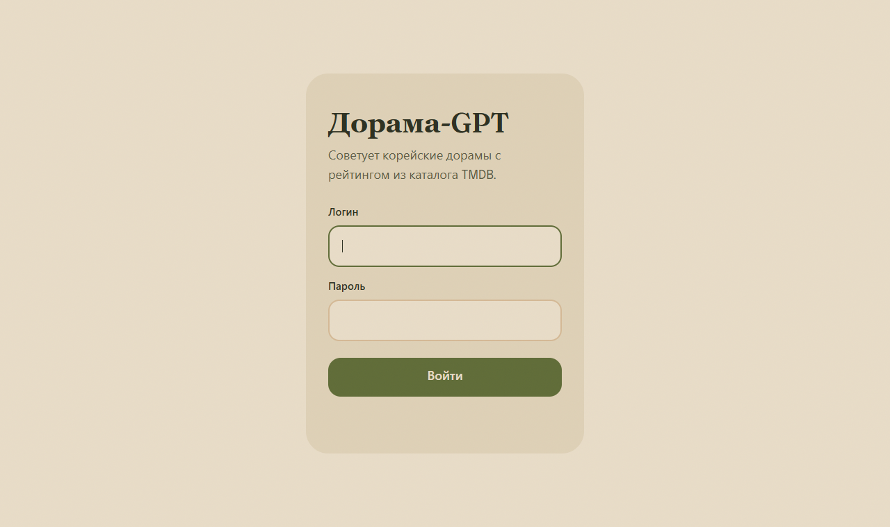
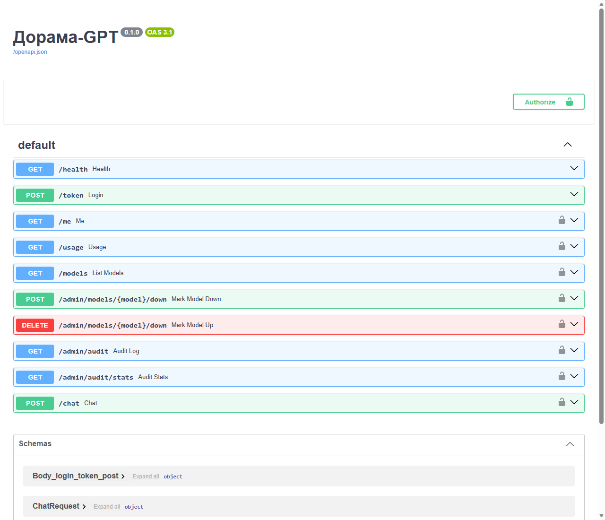

# Дорама-GPT — LLM-шлюз с защитой персональных данных

Чат-ассистент, который быстро подбирает корейские дорамы по жанру, настроению и рейтингу. Под капотом — собственный **LLM-шлюз** на FastAPI: аутентификация OAuth2/JWT, роли и квоты, маскировка персональных данных до и после модели, маршрутизация между моделями с fallback, RAG по каталогу TMDB, трейсинг в Langfuse, метрики в Prometheus/Grafana и журнал аудита в PostgreSQL. Модели работают локально через Ollama — данные не уходят во внешние сервисы.



## Возможности

- **Рекомендации по реальным данным (RAG).** Ответ строится только по каталогу TMDB: название, год, жанры, рейтинг, описание. Модель не выдумывает дорамы, которых нет.
- **Карточки дорам.** Постер, число серий, описание, трейлер на YouTube и актёрский состав с фотографиями — без перехода на сторонние сайты.
- **Guard на входе и выходе.**
  - До модели телефоны, почта, номера карт и IP заменяются метками `[PHONE_1]`, `[EMAIL_1]`…
  - В ответе модели ищутся ПД, которые она выдала сама (`[OUT_PHONE_1]`).
  - Демаскировка: пользователь получает обратно только свои данные из своего же вопроса.
- **Метрики качества Guard.** Контрольный набор размеченных фраз, recall / FPR / задержка, «ворота качества» в тестах.
- **OAuth2 + JWT, роли (RBAC).** `admin`, `user`, `guest`: у каждой роли свой набор моделей и дневной лимит запросов.
- **Квоты и учёт токенов** в Redis: атомарные счётчики запросов и LLM-токенов на пользователя в сутки, `429` при превышении.
- **Маршрутизация и fallback.** Если основная модель недоступна, ответит запасная из разрешённых роли. Флаг «модель недоступна» (feature flag в Redis) переключает администратор.
- **Наблюдаемость.**
  - Langfuse: трейс каждого запроса с шагами `pii-guard → catalog-search → ollama → output-guard`, токены и пользователь. ПД маскируются и в трейсах.
  - Prometheus + Grafana: запросы, p50/p95 времени ответа, ошибки по кодам, токены по моделям, срабатывания Guard, загрузка/память/температура GPU.
- **Журнал аудита** в PostgreSQL: кто, когда, какая модель, какие типы ПД найдены — без самих ПД. Отчёты на SQL (`GROUP BY`) для администратора.
- **Docker и CI.** Гейтвей в контейнере с доступом к GPU, GitHub Actions прогоняет тесты и собирает образ.

## Архитектура



### Как проходит один запрос

1. **Аутентификация.** JWT из заголовка `Authorization: Bearer …`. Нет токена → `401`, модель не разрешена роли → `403`.
2. **Квота.** `INCR` в Redis; лимит исчерпан → `429`, модель не вызывается.
3. **Guard входа.** `Мой номер 999-123-45-67` → `Мой номер [PHONE_1]`. Оригинал остаётся только в памяти запроса.
4. **RAG.** Фильтр по рейтингу («выше 8.5») и поиск по словам в названии, жанрах и описании; в системный промпт попадают 8 лучших дорам.
5. **Модель с fallback.** `qwen2.5:7b`, при сбое — `llama3.2:3b`. Каждая попытка — отдельный шаг трейса. Не ответил никто → `503`.
6. **Guard выхода.** Новые ПД в ответе маскируются, метки из вопроса пользователя возвращаются ему.
7. **Учёт.** Токены в Redis, метрики в Prometheus, трейс в Langfuse, строка в журнале аудита.

## Качество Guard

Контрольный набор: 26 размеченных фраз (`quality/pii_dataset.py`) — с ПД разных форматов, слитным текстом и «ловушками» вроде `версия 1.2.3.4.5` или `рейтинг 9.1`.

| Метрика | Значение | Цель |
|---|---|---|
| Recall: телефон, почта, карта, IP | **100%** | ≥ 95% |
| FPR: чистые фразы с ложным срабатыванием | **0%** | ≤ 5% |
| Задержка Guard на фразу | **< 1 мс** | < 5 мс |
| Recall: имена | 0% | следующий этап |

```bash
python -m quality.metrics
```

Пороги проверяются тестами (`tests/test_quality_gate.py`): правка, ухудшающая Guard, не пройдёт CI.

**Известные ограничения:** имена (нужна NER-модель — Natasha или Presidio + spaCy) и телефоны других стран не распознаются; поиск по каталогу лексический, а не векторный.

## Скриншоты

| Мобильная версия | Вход |
|---|---|
|  |  |

API (Swagger UI):



## Стек

| Задача | Технологии |
|---|---|
| API | Python 3.13, FastAPI, Pydantic, Uvicorn, httpx (async) |
| LLM | Ollama: `qwen2.5:7b` (основная), `llama3.2:3b` (запасная) |
| Безопасность | OAuth2 password flow, JWT (PyJWT), bcrypt, RBAC, маскировка ПД (regex) |
| Данные | TMDB API, PostgreSQL 17 + SQLAlchemy 2 (async, asyncpg), Redis 7 |
| Наблюдаемость | Langfuse (OpenTelemetry), Prometheus, Grafana |
| Инфраструктура | Docker, Docker Compose, GitHub Actions |
| Тесты | pytest, моки (`httpx.MockTransport`, SQLite в памяти) |
| Фронтенд | HTML/CSS/JS без фреймворков |

## Запуск

### Что нужно

- Docker Desktop (для метрик GPU — видеокарта NVIDIA)
- [Ollama](https://ollama.com) с моделями:
  ```bash
  ollama pull qwen2.5:7b
  ollama pull llama3.2:3b
  ```
- Redis на `localhost:6379` и Langfuse на `localhost:3001` ([self-hosted](https://langfuse.com/self-hosting))
- Python 3.13 — для загрузки каталога и тестов
- Ключ TMDB API (бесплатный, [themoviedb.org](https://www.themoviedb.org/settings/api))

### Шаги

1. **Настройки.** Скопировать шаблоны и заполнить своими значениями:
   ```bash
   cp .env.example .env
   cp users.example.json users.json
   ```
   Хеш пароля для `users.json`:
   ```bash
   python guard/auth.py
   ```
2. **Зависимости и каталог дорам** (100 корейских сериалов с лучшим рейтингом, с постерами, трейлерами и актёрами):
   ```bash
   pip install -r requirements.txt
   python -m dramas.tmdb
   ```
3. **Гейтвей и PostgreSQL:**
   ```bash
   docker compose up -d --build
   ```
4. **Мониторинг:**
   ```bash
   docker compose -f monitoring/docker-compose.yml up -d
   ```

| Что | Адрес |
|---|---|
| Чат | http://localhost:8000 |
| Swagger UI | http://localhost:8000/docs |
| Метрики | http://localhost:8000/metrics |
| Prometheus | http://localhost:9095 |
| Grafana (дашборд «Дорама-GPT») | http://localhost:3002 |
| Langfuse | http://localhost:3001 |

Для разработки с автоперезагрузкой вместо контейнера:
```bash
docker compose stop gateway
uvicorn main:app --reload --host 0.0.0.0
```

## API

| Метод | Путь | Доступ | Назначение |
|---|---|---|---|
| `POST` | `/token` | все | вход, выдача JWT |
| `GET` | `/me` | вошедшие | данные из токена |
| `GET` | `/models` | вошедшие | модели, доступные роли |
| `POST` | `/chat` | вошедшие | вопрос → ответ, найденные ПД, источники, токены |
| `GET` | `/usage` | вошедшие | запросы и токены за сегодня |
| `POST` / `DELETE` | `/admin/models/{model}/down` | admin | пометить модель недоступной / вернуть |
| `GET` | `/admin/audit` | admin | последние записи журнала аудита |
| `GET` | `/admin/audit/stats` | admin | сводка по пользователям за N дней |
| `GET` | `/health`, `/metrics` | все | проверка жизни, метрики Prometheus |

## Тесты

```bash
python -m pytest -v
```

Тесты не требуют сети, Docker и моделей: TMDB подменяется `httpx.MockTransport`, база — SQLite в памяти. В CI (`.github/workflows/ci.yml`) на каждый push: тесты → сборка Docker-образа.

## Структура проекта

```
main.py              API: эндпоинты и сборка цепочки обработки запроса
router.py            маршрутизация между моделями, fallback, флаги недоступности
observability.py     клиент Langfuse с маскировкой ПД в трейсах
monitoring.py        метрики Prometheus, сбор данных о GPU через nvidia-smi
guard/
  auth.py            OAuth2/JWT, пользователи, роли
  pii.py             поиск и маскировка ПД
  output.py          Guard выхода и демаскировка
  quota.py           квоты и учёт токенов в Redis
dramas/
  tmdb.py            загрузка каталога из TMDB (постеры, трейлеры, актёры)
  catalog.py         поиск по каталогу и системный промпт
audit/               журнал аудита: модель таблицы и запросы (SQLAlchemy)
quality/             контрольный набор ПД и расчёт recall / FPR
web/index.html       интерфейс чата
monitoring/          Prometheus, Grafana и дашборд как код
tests/               pytest
```

## Дальнейшее развитие

- NER для имён и адресов (Natasha / Presidio) и сравнение recall до и после
- Векторный поиск по каталогу вместо лексического
- Стриминг ответа модели
- HTTPS и защита `/token` от перебора паролей
- Миграции схемы базы (Alembic)

---

Данные о дорамах: [TMDB](https://www.themoviedb.org/). Этот продукт использует API TMDB, но не одобрен и не сертифицирован TMDB.
